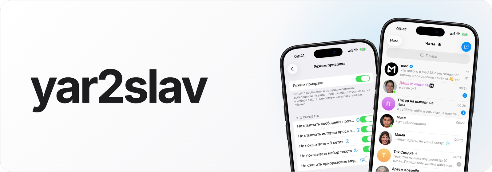

  <picture>
    <source media="(prefers-color-scheme: dark)" srcset="assets/banner-dark.png">
    
  </picture>

  

  
  
  

## about

hey! im yaroslav, 17, from dnipro. i just love all kinds of telegram related shit: clients, bots, apis, basically anything around it

## mad

my telegram client for iphone, windows and mac. ghost mode, deleted messages that just stay in the chat, an ai agent and tons of settings the official app doesnt have. it all lives in [madgram](https://github.com/madgram)

  <a href="https://github.com/madgram">
    <picture>
      <source media="(prefers-color-scheme: dark)" srcset="https://github.com/madgram/.github/raw/main/profile/assets/hero-dark.png">
      
    </picture>
  </a>

| project | | made with |
|---|---|---|
| [mad-iOS](https://github.com/madgram/mad-iOS) | the iphone client: ghost mode, full history of deleted and edited messages, an ai agent on ur own key, chat locks and a feed with no ads |  |
| [mad-desktop](https://github.com/madgram/mad-desktop) | the windows and mac client, basically a [tele](https://github.com/nitreojs/tele) fork with our patches on top |  |
| [mad-installer](https://github.com/madgram/mad-installer) | puts mad on ur iphone in a couple clicks from a mac or windows pc with a free apple id, and renews the signature so u dont have to |  |
| [mad.tg](https://mad.tg/) | the site: prerendered react, pulls the latest releases live and shows the app in light and dark |  |

## peer it

[@peeritbot](https://t.me/peeritbot) is a telegram bot that grabs tracks and videos from pretty much everywhere. just drop a link or type a track name and it sends u the file with the cover and tags. news are in [@peeritnews](https://t.me/peeritnews)

- music: soundcloud, deezer, yandex music, zvuk, vk and spotify, plus search and whole albums
- video: youtube up to 1080p, tiktok (videos, photo carousels, sounds), instagram (reels, posts, stories) and x
- works in dms, groups, inline and telegram business

## more

- [zapostit-api](https://github.com/yar2slav/zapostit-api): typed python client for [zapostit.com](https://zapostit.com), sync and async

## stack

<b>main</b>

  

<b>also</b>

  

<b>infra</b>

  
   
  

  

